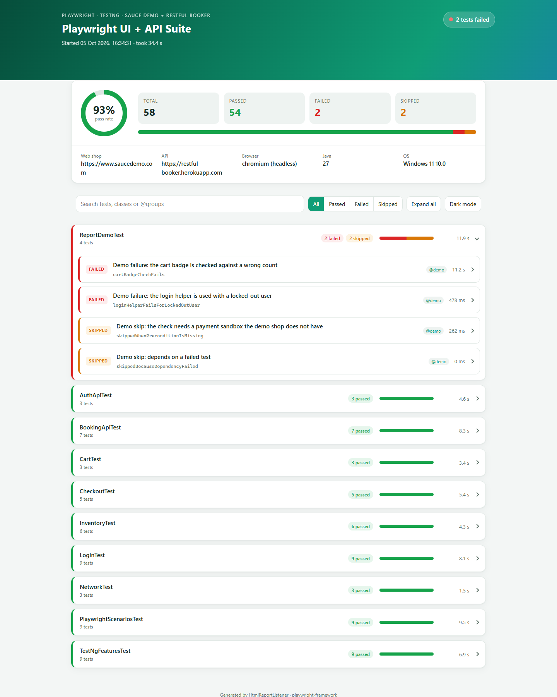
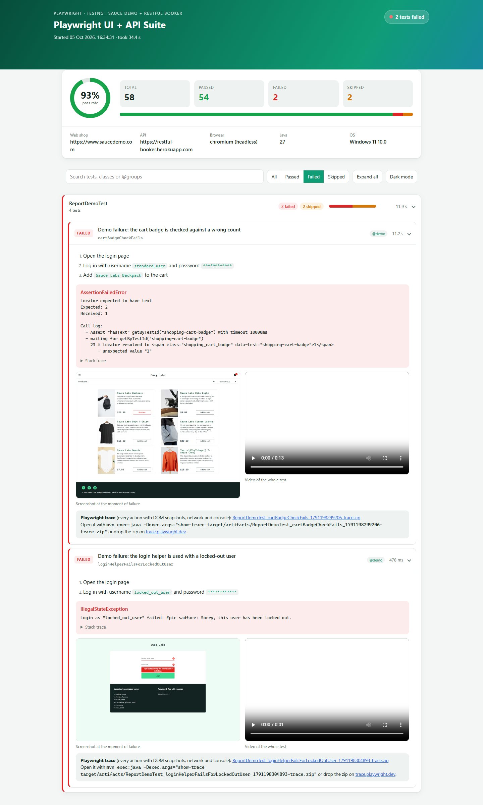

# playwright-framework

Test automation framework built with **Playwright for Java and TestNG**. It tests a web shop through the browser and a REST API directly, both with Playwright, and runs on **Chromium, Firefox and WebKit**.

- **UI:** the [Sauce Demo](https://www.saucedemo.com) shop: login, product list, sorting, cart and a full checkout.
- **API:** the [Restful Booker](https://restful-booker.herokuapp.com) API: auth and booking create, read, search, update, patch and delete, including error cases.
- **Network:** blocking requests, watching every response, and mocking a server response in the browser.
- **Interview scenarios:** common Playwright tasks (locator strategies, keyboard, tabs, saved login, JavaScript, dialogs, waiting for responses, broken images) and TestNG features (soft asserts, dependencies, retries, parameters…), each as a small working test, plus an [interview questions PDF](docs/interview-questions.pdf) whose answers link to this code.

When a UI test fails, its **screenshot, video and Playwright trace** are kept and linked from a self-contained HTML report.



*Report of a full run with the demo tests (`mvn clean test -Pdemo`): 58 tests, 54 passed, plus 2 failures and 2 skips on purpose. Each test class is one collapsible row; the class with a failure opens by default.*

## Tech stack

| | |
|---|---|
| Language | Java 17 |
| Browser and API automation | Playwright for Java 1.63 (Chromium, Firefox, WebKit; `APIRequestContext` for HTTP) |
| Test runner | TestNG 7.12 (groups, data providers, parallel classes) |
| JSON | Jackson 2.22 (Java records map to and from JSON) |
| Build | Maven (Surefire 3.5, exec plugin for the Playwright CLI) |
| CI | GitHub Actions: one job per browser engine |
| Report | Custom TestNG `IReporter`: one HTML file with screenshots, videos and traces |

## Project structure

```
playwright-framework
├── .github/workflows/tests.yml        CI: the suite on Chromium, Firefox and WebKit
├── docs/images/                       Report screenshots used in this README
├── docs/interview-questions.pdf       Playwright + TestNG interview questions, linked to this code
├── pom.xml
├── testng.xml                         Suite for running from the IDE
└── src
    ├── main/java/com/automation/playwright
    │   ├── config      Config: config.properties + -D overrides
    │   ├── browser     BrowserManager: Playwright + browser per thread, context per test, trace + video
    │   ├── pages       BasePage, ShopPage (header, cart, menu), LoginPage, InventoryPage, ProductPage,
    │   │               CartPage, CheckoutInfoPage, CheckoutOverviewPage, CheckoutCompletePage
    │   ├── api         ApiClient (Playwright request context), BookingApi, ApiResponse, Json,
    │   │               model: Booking, BookingDates, CreatedBooking (records)
    │   ├── report      HtmlReportListener (custom HTML report)
    │   └── utils       Steps: records test steps for the report
    ├── main/resources/META-INF/services   Registers the report listener with TestNG
    ├── test/java/com/automation/playwright
    │   ├── base        PlaywrightTest, UiTest (context per test, failure artifacts), ApiTest (client + cleanup),
    │   │               RetryOnce (retry analyzer)
    │   ├── data        TestData: users, products, data providers, generated bookings
    │   └── tests       ui: LoginTest, InventoryTest, CartTest, CheckoutTest
    │                   api: AuthApiTest, BookingApiTest
    │                   network: NetworkTest
    │                   interview: PlaywrightScenariosTest, TestNgFeaturesTest
    │                   demo: ReportDemoTest (fails and skips on purpose)
    └── test/resources/config.properties
```

## How it works

- **One Playwright per thread, one context per test.** Playwright objects must not be shared between threads, so `BrowserManager` keeps a Playwright and a browser per thread and reuses them. Every UI test gets a fresh `BrowserContext` (own cookies and storage), which is fast and keeps tests isolated, so test classes run in parallel safely.
- **No waits in the tests.** Playwright waits for elements to be ready before acting, and its `assertThat(...)` checks retry until the page matches. Pages only add a `waitUntilLoaded()` that waits for an element unique to that page, because Sauce Demo changes the URL before it draws the new page (WebKit showed this).
- **Locators by test id.** Sauce Demo marks elements with `data-test`; `selectors().setTestIdAttribute("data-test")` makes `page.getByTestId("login-button")` use it. Cards are found with `filter(has: ...)`, buttons by role and name.
- **API through Playwright too.** `ApiClient` wraps Playwright's `APIRequestContext`; requests and responses are JSON via Jackson records, and every call is logged as a step, e.g. *POST "/booking" → 200 (312 ms)*.
- **API test data setup and cleanup.** API tests create their own bookings through the API (`givenBooking(...)`), and `ApiTest` deletes them after each test, so the shared demo API is left as it was.
- **Clear login failures.** `LoginPage.loginAs` waits for whichever comes first, the product list or the error banner (`locator.or(...)`), and throws the shop's message at once (*Login as "locked_out_user" failed: …*) instead of timing out.
- **Failure evidence.** Every UI test records a trace and a video; for a passed test both are discarded, for a failed one they are kept in `target/artifacts` with a full-page screenshot.

## Tests

| Class | Group | Tests |
|---|---|---|
| `LoginTest` | `login` | Standard user sees the products (`smoke`) · login rejected ×5 (data provider: wrong password, unknown user, missing username, missing password, locked-out user) · logout (`smoke`) · Back after logout does not show the products · product list requires a login |
| `InventoryTest` | `inventory` | Products sorted ×4 (A–Z, Z–A, price low–high, high–low) · every product has a name and a price · product details match the list (`smoke`) |
| `CartTest` | `cart` | Added products appear in the cart (`smoke`) · removing the only product empties the cart · the cart survives a reload |
| `CheckoutTest` | `checkout` | Full purchase: item total = sum of prices, total = item total + tax, confirmation (`smoke`) · each missing buyer field ×3 · cancelling the checkout keeps the cart |
| `AuthApiTest` | `api` | Health check (`smoke`) · admin gets a token · a wrong password gets no token (the API answers 200 with "Bad credentials") |
| `BookingApiTest` | `api` | Created booking can be read back (`smoke`) · found by name · PUT replaces · PATCH changes only given fields · changes need a token (403) · deleted booking is gone (201, then 404) · unknown booking 404 |
| `NetworkTest` | `network` | Shop works with images blocked · no failing requests while shopping (`smoke`) · mocked response replaces the server's |
| `PlaywrightScenariosTest` | `interview` | Five locator strategies find the same field (test id, placeholder, CSS, XPath, role) · keyboard-only login · a second tab shares the login · a saved login (`storageState`) skips the login form · JavaScript reads the page and local storage (`evaluate`) · element screenshot is a PNG · a browser dialog is read and accepted · `waitForResponse` for the product images · product images not broken (checked with `page.request()`), except for `problem_user` |
| `TestNgFeaturesTest` | `interview` | `SoftAssert` · `expectedExceptions` + message regex · `priority` + `dependsOnMethods` (2 tests) · `invocationCount = 2` · `timeOut` · `retryAnalyzer` (`RetryOnce`) · `@Parameters` + `@Optional` |
| `ReportDemoTest` | `demo` | **On purpose**, to show the report (excluded by default): 2 failures (a wrong assertion; the login helper with a locked-out user) and 2 skips (`SkipException`; a failed dependency) |

A normal run has **54 tests** (36 core + 18 interview) and takes about 30–35 s on Chromium (3 threads). A full run with `-Pdemo` has 58: the same 54 passed plus 2 failed and 2 skipped on purpose.

Latest results (5 Oct 2026, headless, 3 threads):

| Browser | Tests | Passed | Time |
|---|---|---|---|
| Chromium | 54 | 54 | 32.1 s |
| Firefox | 54 | 54 | 54.3 s |
| WebKit | 54 | 54 | 44.4 s |

Running all three engines found two real cross-browser differences, both fixed: Firefox reports image downloads it cancels when the page moves on (the network test now ignores browser cancellations), and WebKit showed the old page for a moment after the URL changed (pages now wait for their own unique element).

## How to run

Requirements: JDK 17 or newer and Maven. Playwright downloads its own browsers:

```bash
mvn exec:java -Dexec.args="install"          # once: download Chromium, Firefox and WebKit
mvn clean test                               # all tests, headless Chromium
mvn clean test -Dbrowser=firefox             # chromium (default), firefox or webkit
mvn clean test -Dgroups=api                  # one group: smoke, login, inventory, cart, checkout, api, network or interview
mvn clean test -Dtest=CheckoutTest           # one class
mvn clean test -Dheadless=false -DslowMo=300 # watch the browser, slowed down
mvn clean test -Dthreads=1                   # run the classes one after another
mvn clean test -Pdemo                        # also run the demo tests (2 fail, 2 skip on purpose)
```

In the IDE, run `testng.xml` (it also sets the `apiUser` suite parameter) or any test class or method directly.

### Configuration

`src/test/resources/config.properties`; every key can be overridden with `-Dkey=value`:

| Key | Default | Meaning |
|---|---|---|
| `baseUrl` | `https://www.saucedemo.com` | Web shop under test |
| `password` | `secret_sauce` | Password of the Sauce Demo users |
| `apiUrl` | `https://restful-booker.herokuapp.com` | REST API under test |
| `apiUser` / `apiPassword` | `admin` / `password123` | API admin (public demo account) |
| `browser` | `chromium` | `chromium`, `firefox` or `webkit` |
| `headless` | `true` | `false` shows the browser |
| `slowMo` | `0` | Pause in ms after each action |
| `timeoutMillis` | `10000` | Timeout for actions and assertions |
| `trace` / `video` | `true` | Record a trace and video per UI test (kept for failures only) |

## Reports

| Output | Location |
|---|---|
| HTML report | `target/surefire-reports/playwright-test-report.html` (`test-output/` when run from the IDE) |
| Failure screenshots, videos, traces | `target/artifacts/<Class>_<method>_<time>-screenshot.png`, `-video.webm`, `-trace.zip` |
| TestNG / Surefire reports | `target/surefire-reports/` |

The report shows the pass rate, the environment, and each test class as a collapsible row with its counts, a result bar and its total time; classes with a failure come first and start open. Every test lists its steps (page actions and API calls with status and time). A failed UI test also shows its screenshot, a video player and a link to its trace. Search, status filters, expand/collapse all and a dark mode are built in; on opening, the counters count up and the ring and bars fill (left out when the system asks for reduced motion).



Open a trace, which replays every action with DOM snapshots, network and console:

```bash
mvn exec:java -Dexec.args="show-trace target/artifacts/<file>-trace.zip"
```

or drop the zip on [trace.playwright.dev](https://trace.playwright.dev).

## Interview questions

[`docs/interview-questions.pdf`](docs/interview-questions.pdf): Playwright for Java + TestNG interview questions with answers. Every answer has an explanation, a short example and an **In the framework** link to the file in this repository that does it (or why it is not used), and the PDF ends with a reference table and links to the official documentation.

## CI

`.github/workflows/tests.yml` runs on every push and pull request: one job each for Chromium, Firefox and WebKit. Each job installs its browser with the Linux libraries it needs, runs the tests headless, and keeps the HTML report plus any failure screenshots, videos and traces as a downloadable artifact.

## Adding a test

1. Add or extend a page object in `pages` (extend `ShopPage` for pages after login), use `getByTestId` or role-based locators, add a `waitUntilLoaded()` with an element unique to the page, and log each user action with `Steps.log`.
2. Write the test in `tests/ui`, extending `UiTest`, and check with Playwright's `assertThat`, which waits by itself.
3. For an API test, extend `ApiTest`, add the endpoint to `BookingApi` (or a new `*Api` class), and create test data with `givenBooking(...)` so it is cleaned up.
4. Give the test a `description` and a group.
